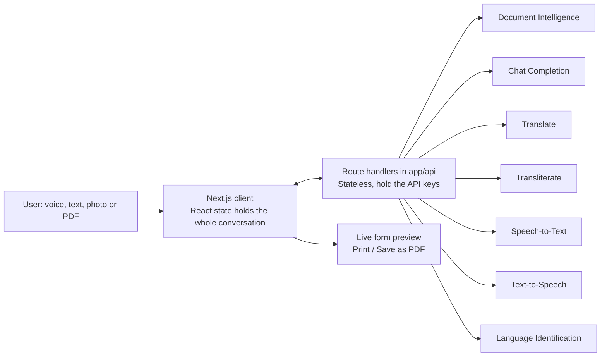
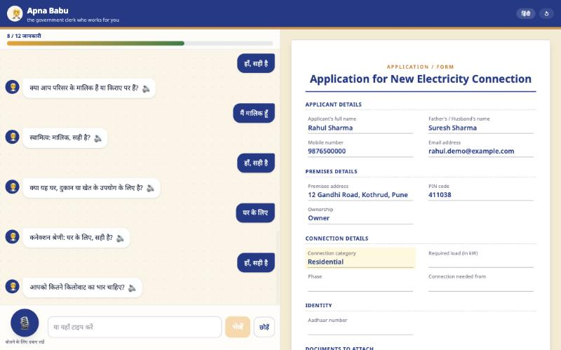
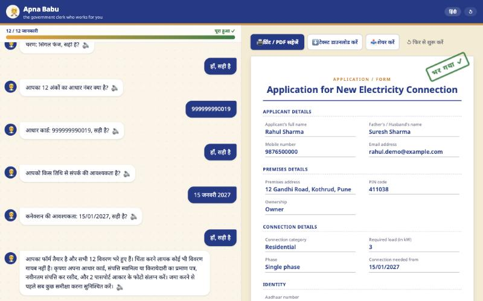

# 🧑‍💼 Apna Babu

**Every Indian has paid a tout to fill a form. Apna Babu does it free, in your language.**

Apna Babu is the government clerk who works for you: a voice-first assistant that fills any paper form, or answers any official letter, for people who can't comfortably read or write English.

**Live demo:** https://apna-babu.vercel.app

## The problem

Bank forms, scholarship applications, electricity connections and court notices are mostly written in English or in formal officialese. Millions of people pay touts outside government offices to fill a single page, or give up on what they are entitled to. They can answer every question on the form. They just can't read it.

## How it works

1. **Upload** a photo or PDF of a form or official document, or pick a built-in sample.
2. **Read:** Sarvam Vision reads the page and the chat model works out which details are needed. If it's a bill, notice or summons rather than a form, Babu explains it and proposes the right reply (complaint, reply letter, RTI application).
3. **Choose a language:** English, हिंदी, मराठी or Hinglish.
4. **Understand:** Babu explains the document in plain spoken language: what it is, what it says about you, every amount and deadline exactly as printed, and what to do next. Ask it anything, by voice or typing, then say "start" when you are ready. You can keep asking at any point, even after the form is done.
5. **Talk:** Babu asks for one detail at a time, out loud, then the mic opens by itself. Your answer goes in when you tap Done or pause for 2 seconds, or you can type instead. Spoken numbers and dates are normalised, every value is validated and read back for confirmation, and the form on screen fills in live, in the form's own language whichever language you spoke.
6. **Done:** a print-ready form with a "FILLED ✓" stamp, a spoken summary of what's missing and what to carry, and print, download and share buttons.

Long forms are condensed to the 25 details that matter most, so check the printed copy against the original.

## Supported languages

English, Hindi, Marathi and Hinglish (Roman script), with more coming. Languages live in one config file, [`lib/languages.ts`](lib/languages.ts).

## Sarvam APIs used

| API | Model | What it does in Apna Babu |
| --- | --- | --- |
| Document Intelligence | Sarvam Vision | Reads the uploaded photo or PDF into text, as an async job the app polls (`/api/doc/*`) |
| Chat Completion | `sarvam-105b-conversations` and `gemma4` | Builds the field schema, extracts each answer, generates the closing summary, and drafts reply letters. `gemma4` writes explanations and answers to questions directly in your language, and any sentence quoting a figure that isn't in the document is dropped |
| Translate | `mayura:v1`, `sarvam-translate:v1` for Marathi | Translates every question, label, validation message and summary. All questions are translated once, right after you pick a language, so each turn is fast. Hinglish uses `code-mixed` mode. Any number that changes in translation is restored from the English |
| Text-to-Speech | `bulbul:v4-flash` | Speaks every line in one consistent voice across all four languages |
| Speech-to-Text | `saaras:v4` | Transcribes answers, in `codemix` mode for Hinglish. A second auto-detect pass catches the language actually being spoken |
| Language Identification | `/text-lid` | Notices when you speak a different language from the one you chose, and offers to switch |
| Transliterate | `/transliterate` | Devanagari names and addresses to Latin for English forms, Roman to Devanagari for Hindi or Marathi forms, and Hinglish between Roman (display) and Devanagari (voice) |

## Architecture



The server stores nothing. Conversation state stays in the browser and is sent with each request. All Sarvam calls happen on the server through [`lib/sarvam.ts`](lib/sarvam.ts), which retries once with the fallback key on auth or quota errors.

## Screenshots

Made-up demo data.

| Filling a form in Hindi | Finished form |
| --- | --- |
|  |  |

## Local setup

```bash
npm i
```

```bash
cp .env.example .env.local
```

Fill in the keys in `.env.local`, then:

```bash
npm run dev
```

To test every API route against a running server (it makes real Sarvam calls):

```bash
npm run smoke
```

### Environment variables

| Name | Purpose |
| --- | --- |
| `SARVAM_API_KEY` | Primary Sarvam API key |
| `SARVAM_API_KEY_FALLBACK` | Used automatically when the primary key hits an auth or quota error |

## Future scope

- All 22 scheduled Indian languages
- Rehearsal mode, "Taiyaar": practise an office visit or interview with Babu
- WhatsApp bot
- Feature phones and IVR through Sarvam voice agents
- Common Service Centre partnerships

## Team

- Saksham Singh Sisodiya ([github.com/SakshamSinghSisodiya](https://github.com/SakshamSinghSisodiya))
- Parth Dande ([github.com/Parth-Dande](https://github.com/Parth-Dande))

Built at Sarvam Campus x MIT-WPU.

---

Draft prepared for assistance. Please review before submitting. Not legal advice.
